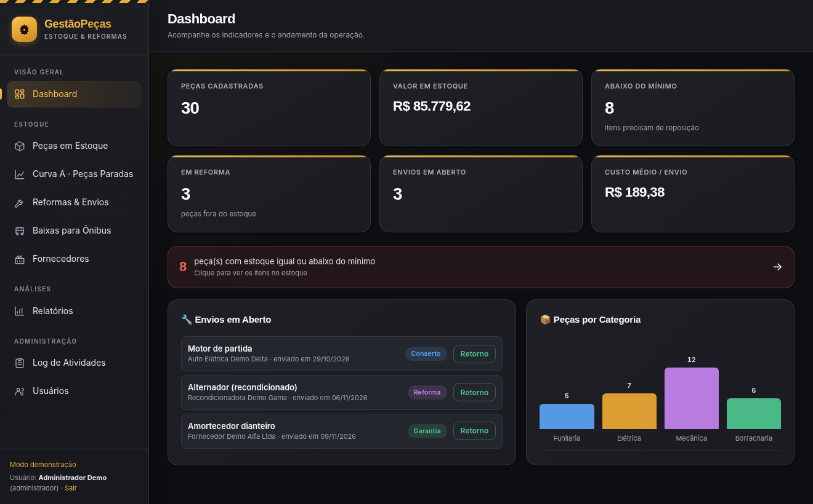

# GestãoPeças

Sistema web para gestão de peças, movimentações de estoque, reformas e fornecedores.

Este repositório contém uma demonstração com dados fictícios e integração simulada com ordens de serviço.

**Demonstração online:** publique esta versão em GitHub Pages ou Netlify e adicione o endereço aqui. O projeto também funciona abrindo `index.html` localmente, sem cadastro nem banco externo.

> Acesse o modo demonstração com **Administrador Demo** para explorar os relatórios e os logs, ou com **Usuário Demo** para conferir as permissões.

## Sobre o projeto
O sistema centraliza o cadastro de peças, o acompanhamento das movimentações e o controle de itens enviados para reforma. Também reúne custos e indicadores em um único painel.

## Funcionalidades
- **Estoque**: cadastro de peças, categorias, localização, estoque mínimo com alertas, busca, filtros, paginação e exportação CSV
- **Entradas** com **média ponderada histórica de compras** (ajustes manuais são registrados sem reescrever entradas)
- **Baixas para ônibus** (status Realizado / Pendente / Extra-Saldo), agrupadas por peça, ônibus ou data, com exportação CSV
- **Curva A · Peças Paradas**: estoque secundário para itens parados (denominação interna; não é uma análise ABC tradicional)
- **Reformas, consertos e garantias**: envio, acompanhamento e retorno
- **Fornecedores** e **ranking de fornecedores**
- **Dashboard** e **relatórios** (gastos mensais, valor do estoque, etc.), com exportação de envios e ranking em CSV
- **Auditoria**: log de atividades (somente administradores)
- **Usuários e perfis** (admin/usuário) com Firebase Authentication
- Validação de **ordem de serviço aberta** antes da baixa (integração simulada)

## Tecnologias
HTML, CSS e JavaScript puro (sem build) · Firebase Authentication · Firebase Realtime Database (opcional).

## Arquitetura
```
index.html            estrutura das telas e modais
css/                  style.css (tema/layout) · components.css (componentes)
js/
  utils.js            formatação, constantes, helpers
  firebase.js         camada de dados: backend Firebase OU backend de demonstração (mesma interface `Dados`)
  firebase-config.js  configuração (vazia = modo demonstração)
  manutencao.js       integração SIMULADA com sistema de manutenção (ordens de serviço)
  auth.js             sessão, login, perfis e permissões
  usuarios.js         gestão de usuários (admin)
  estoque.js          peças, entradas, curva A
  fornecedores.js     fornecedores e ranking
  reformas.js         envios e retornos
  baixas.js           baixas para ônibus
  dashboard.js        dashboard e relatórios
  exportacao.js        exportações CSV (UTF-8, compatível com Excel)
  auditoria.js        log de atividades
  app.js              navegação, renderização e inicialização
data/demo-data.json   dados fictícios (data/demo-data.js é a mesma cópia, para abrir sem servidor) (peças, fornecedores, envios, baixas, logs, usuários, OS)
database.rules.json   Security Rules do Realtime Database
docs/                 FIREBASE.md · PERMISSOES.md · screenshots/
```
A aplicação usa scripts clássicos que compartilham o escopo global (sem módulos ES), carregados na ordem do `index.html`.

## Como executar (modo demonstração)
Basta abrir o `index.html` no navegador. Se preferir um servidor local:
```bash
python3 -m http.server 8000
# abra http://localhost:8000
```
Escolha "Administrador Demo" ou "Usuário Demo" na tela de entrada (não há senha no modo demo).
As alterações ficam em memória e são perdidas ao recarregar a página.

Dica: a baixa para o ônibus **108** é bloqueada de propósito (sem OS aberta na simulação); os ônibus 101–107, 109 e 110 têm OS aberta.

## Configurar com Firebase (opcional)
Veja [docs/FIREBASE.md](docs/FIREBASE.md): copie `js/firebase-config.example.js` para `js/firebase-config.local.js`
(ignorado pelo Git), publique `database.rules.json` e crie o primeiro administrador.
Use sempre um projeto Firebase **separado** de qualquer ambiente real.

## Dados de demonstração
`data/demo-data.json` contém dados 100% fictícios (ex.: "Filtro de óleo", PEC-001, "Fornecedor Demo Alfa Ltda", ônibus 101).
Para alterar a demonstração, **atualize `data/demo-data.js` e `data/demo-data.json` juntos**. O arquivo JavaScript é usado primeiro ao abrir localmente; o JSON serve como alternativa ao usar servidor. Para atualizar os dois sem divergências, use `python3 scripts/sincronizar-demo.py` após editar o JSON.

## Segurança
Autenticação por Firebase Authentication no modo opcional, perfis por `role` e regras de acesso iniciais do banco. **O modo Firebase é experimental** e requer testes das regras, validações no backend e auditoria de logs antes do uso em produção.
Detalhes em [docs/PERMISSOES.md](docs/PERMISSOES.md) e [docs/FIREBASE.md](docs/FIREBASE.md).
A integração de ordens de serviço é simulada nesta versão.

## Demonstração visual


## Screenshots
| Dashboard | Estoque | Baixas |
|---|---|---|
|  |  |  |

## Testes
Para executar os testes automatizados de regressão (Chromium instalado e `pip install playwright`):
```bash
python3 tests/test_demo.py
python3 tests/test_melhorias.py
```
Em outros sistemas, defina `CHROMIUM_BIN` com o caminho do Chromium. Os testes abrangem as baixas, saldo, entradas, histórico de custos, envios, XSS, exportação CSV, notificações, navegação acessível e responsividade mobile.

O GitHub Actions executa esses testes automaticamente a cada *push* e *pull request*, em `.github/workflows/testes.yml`. Os testes do Firebase real no Emulator Suite são uma etapa separada.

## Limitações conhecidas
- Coleções operacionais são gravadas como um array inteiro: edições simultâneas podem se sobrepor (última gravação vence), e as regras não distinguem criar/editar/excluir dentro de uma coleção.
- O front-end esconde telas por perfil, mas a proteção efetiva é feita pelas Security Rules (que ainda devem ser testadas no Emulator Suite).
- Excluir usuário remove o perfil, não a conta no Firebase Authentication (exige Admin SDK/Cloud Function).
- Testes de regressão disponíveis em `tests/` (dependem de Playwright/Chromium); sem build/empacotamento.
- Fontes e SDK do Firebase são carregados de CDNs públicas.

## Regras de negócio
- O custo exibido é a **média histórica ponderada das entradas**, não o custo contábil médio móvel. Uma edição manual do valor atual gera um ajuste sem reescrever entradas anteriores; a próxima entrada volta a considerar a média histórica.
- Uma baixa com status **Realizado** desconta o saldo somente se houver estoque suficiente. **Extra-Saldo** e **Pendente** não descontam.
- As quantidades são inteiras para peças por unidade; `kg`, `m` e `litro` admitem frações.

## Melhorias futuras
- Gravações granulares por registro (`push`/`update`) e regras por tipo de operação
- Cloud Functions para criação/remoção completa de usuários e para a integração real de manutenção
- Testes de regras no Firebase Emulator, cobertura unitária adicional e monitoramento em produção
- Exportação em PDF e importação de planilhas
- Módulos ES e bundler

## Publicar a demonstração

1. Envie o conteúdo da pasta `GestaoPecas/` para a raiz do repositório.
2. Em **Settings → Pages**, escolha **Deploy from a branch**, `main` e `/ (root)`, ou conecte o repositório ao Netlify.
3. Abra o endereço publicado em uma aba anônima e confira os dois perfis demo.
4. Atualize o campo **Demonstração online** no início deste README com o endereço **da versão nova**, não com links de ambientes de trabalho.

**Aviso:** não configure o Firebase de produção em uma demonstração pública. A publicação estática usa dados fictícios em memória e reinicia após atualizar a página.
