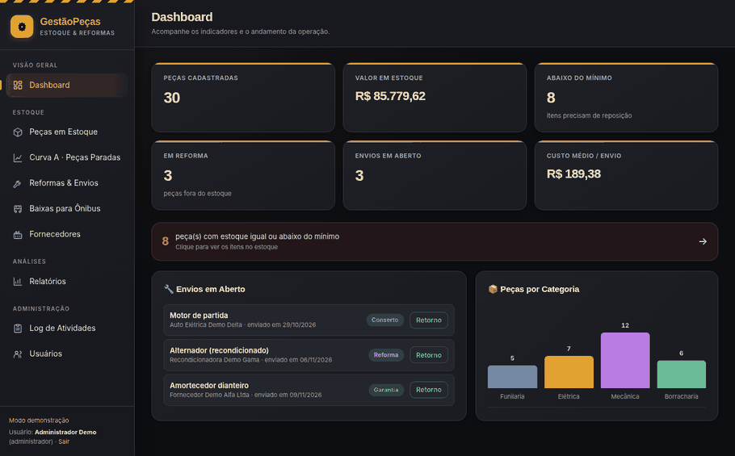
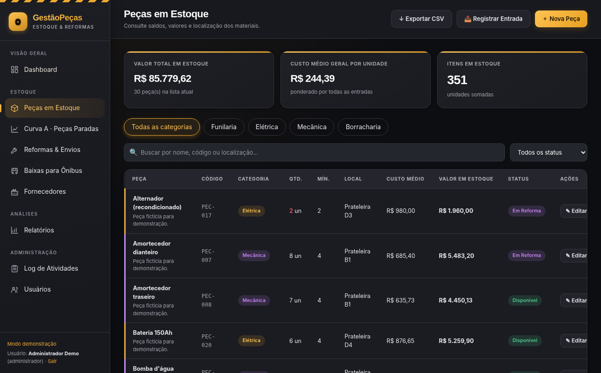
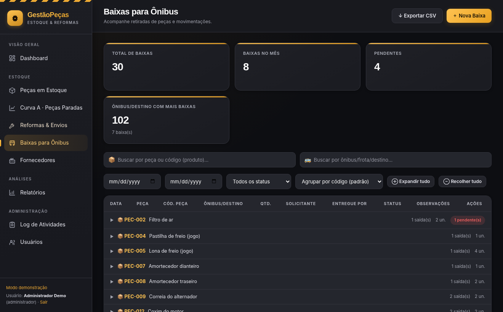

# GestãoPeças

[](https://github.com/mateusfaria854-bit/gestao-pecas/actions/workflows/testes.yml)

**Sistema web de gestão de almoxarifado**, desenvolvido com HTML, CSS e JavaScript. Permite acompanhar peças, movimentações, custos, fornecedores, reformas e indicadores em um único painel.

[**Experimentar demonstração**](https://mateusfaria854-bit.github.io/gestao-pecas/) · [**Ver arquitetura**](docs/ARQUITETURA.md) · [**Acompanhar melhorias**](https://github.com/mateusfaria854-bit/gestao-pecas/issues)

> **Demonstração pública:** todos os dados são fictícios. Não é necessário criar conta, informar senha nem configurar Firebase. Selecione **Administrador Demo** ou **Usuário Demo** para explorar os perfis. Os dados ficam na memória do navegador e são reiniciados ao recarregar a página.

## Por que esse projeto existe?

Rotinas de almoxarifado exigem informações consistentes sobre disponibilidade, entradas, saídas, custos e o andamento de itens enviados para reforma. O GestãoPeças reúne essas operações em uma interface única e oferece relatórios para apoiar o acompanhamento do estoque.

O projeto combina regras de negócio do cotidiano operacional com desenvolvimento web. A versão pública foi separada de ambientes reais para permitir que qualquer pessoa avalie a aplicação com segurança.

## Demonstração



| Dashboard | Estoque | Baixas |
|---|---|---|
|  |  |  |

**Fluxo sugerido de teste:** entrar como Administrador Demo → consultar o dashboard → cadastrar ou editar uma peça → registrar uma entrada ou baixa → abrir relatórios e exportar CSV.

## Funcionalidades

- **Estoque:** cadastro e edição de peças, localização, estoque mínimo, filtros, busca, paginação e exportação CSV.
- **Movimentações:** entradas, baixas por ônibus e histórico de operações.
- **Custos:** média histórica ponderada das entradas e indicadores gerenciais.
- **Peças paradas:** separação de itens no módulo denominado internamente *Curva A*. Não se trata da classificação ABC tradicional.
- **Reformas e garantias:** envios, acompanhamento e retornos.
- **Fornecedores:** cadastro, consultas e ranking.
- **Relatórios:** visão de custos e movimentações, além de exportação CSV.
- **Perfis e auditoria:** navegação por perfil de demonstração e logs acessíveis ao administrador.
- **Ordens de serviço:** integração simulada que valida a existência de OS aberta antes da baixa.

## Tecnologias

| Camada | Tecnologias |
|---|---|
| Interface | HTML5, CSS3, JavaScript |
| Organização | Módulos ES, separação por responsabilidades e script de build |
| Dados da demonstração | Dados fictícios em memória, sem backend |
| Persistência opcional | Firebase Authentication e Firebase Realtime Database |
| Qualidade | Testes unitários com Node.js, testes de regressão com Playwright e GitHub Actions |

O Firebase é **opcional e experimental**: não está conectado à demonstração pública e não deve ser usado com dados produtivos sem validar regras de acesso e cenários concorrentes.

## Organização do projeto

```text
src/
├── core/          Inicialização, estado e configuração
├── domain/        Regras de negócio independentes da interface
├── services/      Acesso aos dados e integração simulada
├── features/      Funcionalidades e controladores por área
├── components/    Modais e notificações
├── utils/         Funções auxiliares
├── styles/        Estilos por responsabilidade
└── main.js        Entrada dos módulos ES

dist/app.js         Bundle gerado para a interface atual
data/               Dados fictícios
docs/               Arquitetura, instruções e capturas
scripts/            Build e sincronização dos dados demo
tests/              Testes integrados e unitários
index.html          Página principal
```

**Decisões técnicas:** a lógica de validação, custos e baixas foi extraída para `src/domain/`, permitindo testes sem navegador. Os controladores de interface chamam a camada de dados, que pode operar em memória ou, quando configurada separadamente, via Firebase. Um bundle de compatibilidade preserva os eventos HTML existentes enquanto essa migração é concluída.

Detalhes da organização e das limitações: [documentação de arquitetura](docs/ARQUITETURA.md).

## Processo de desenvolvimento (SDD)

Mudanças de funcionalidades seguem um fluxo leve de **Spec-Driven Development**: especificação de comportamento, plano técnico, tarefas rastreáveis, implementação e validação. O objetivo é manter decisões e critérios de aceite acessíveis no próprio repositório, inclusive ao trabalhar com agentes de IA.

- [Processo e comandos](docs/SDD.md) · [Especificações](specs/README.md) · [Decisões arquiteturais](docs/adr/0001-sdd-incremental.md)
- [Guia para agentes de programação](AGENTS.md) · [Integração Claude Code](.claude/skills/gestao-pecas-sdd/SKILL.md)

```bash
npm run spec:new -- nome-da-funcionalidade
npm run spec:check
npm run arch:check
```

## Executar localmente

O arquivo `index.html` funciona diretamente no navegador com o bundle incluído. Para utilizar um servidor HTTP local:

```bash
python3 -m http.server 8000
# abra http://localhost:8000
```

Ao alterar arquivos JavaScript em `src/`, é necessário gerar novamente o bundle usando **Node.js 22 ou superior**:

```bash
npm run build
```

A demonstração não exige autenticação real nem configuração de banco. O ônibus **108** não possui OS aberta na simulação e serve como cenário de validação de erro.

Para modificar os dados fictícios, edite `data/demo-data.json` e sincronize a cópia para abertura local:

```bash
python3 scripts/sincronizar-demo.py
```

## Testes e qualidade

```bash
npm run build
npm test
python3 tests/test_demo.py
python3 tests/test_melhorias.py
```

Os testes de integração exigem **Python, Playwright e Chromium**. A automação em [GitHub Actions](https://github.com/mateusfaria854-bit/gestao-pecas/actions/workflows/testes.yml) executa o build, os testes unitários e os cenários de regressão a cada atualização.

Os cenários cobrem, entre outros pontos, quantidades inválidas, saldo insuficiente, edição de baixas, custos, segurança da exportação CSV, navegação por teclado e responsividade.

## Segurança e limitações

- A publicação utiliza **dados fictícios**; credenciais e informações internas de empresas não fazem parte do repositório.
- O modo Firebase usa configurações externas e precisa de testes de segurança no Emulator Suite antes de uso real.
- A gravação de coleções inteiras no Firebase opcional pode gerar conflito entre edições simultâneas. A demo local não possui esse problema entre visitantes.
- A exclusão de um perfil não remove automaticamente a conta do Firebase Authentication.
- Eventos inline ainda são mantidos por compatibilidade. A migração completa está planejada.

Mais informações em [Firebase](docs/FIREBASE.md) e [Permissões](docs/PERMISSOES.md).

## Roadmap

As próximas melhorias estão registradas em Issues, com objetivos e critérios de aceite:

1. [Concluir módulos ES e remover eventos inline](https://github.com/mateusfaria854-bit/gestao-pecas/issues/2)
2. [Testar regras do Firebase no Emulator Suite](https://github.com/mateusfaria854-bit/gestao-pecas/issues/3)
3. [Evoluir a persistência concorrente no Firebase](https://github.com/mateusfaria854-bit/gestao-pecas/issues/4)
4. [Aprimorar a experiência mobile e a acessibilidade](https://github.com/mateusfaria854-bit/gestao-pecas/issues/5)
5. [Exportar PDF e importar planilhas com validação](https://github.com/mateusfaria854-bit/gestao-pecas/issues/6)

## Autor

Desenvolvido por [Mateus Faria Andrade](https://github.com/mateusfaria854-bit), estudante de Engenharia de Software na Universidade de Rio Verde (UniRV).

